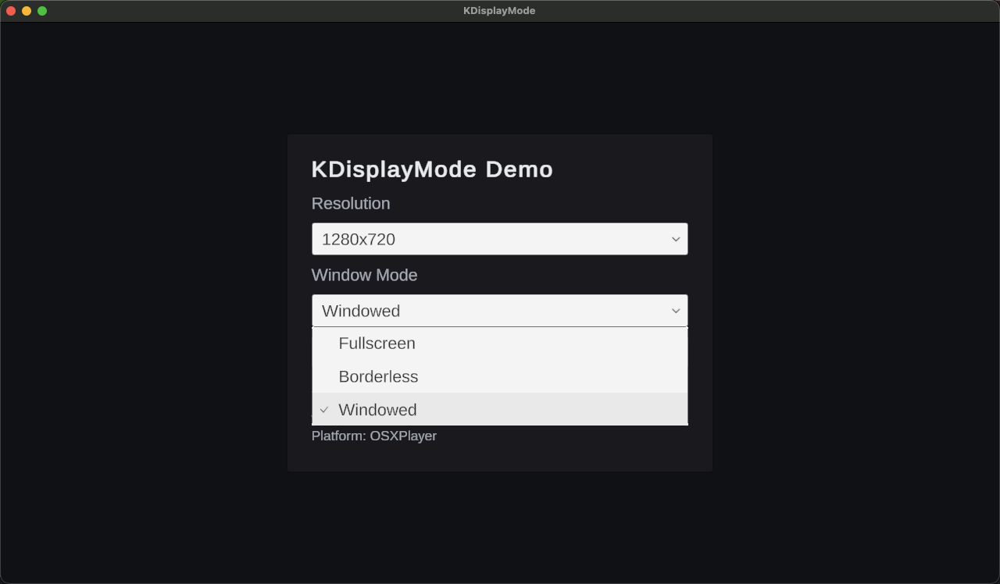

# KDisplayMode

[](https://github.com/vailKAKO/KDisplayMode/releases)
[](https://unity.com/releases/editor/archive)
[](LICENSE)

[English](README.md) | 日本語

Unity の Windows / macOS スタンドアロン向けに、解像度とウィンドウモードを切り替えるパッケージです。
フルスクリーン・ボーダーレス・ウィンドウの 3 つから選ぶと、OS ごとに適切な `FullScreenMode` に変換して適用します。



## 機能

- Windows と macOS で同じように動く 3 つのウィンドウモード（[OS ごとのウィンドウモード](#os-ごとのウィンドウモード)を参照）
- 設定画面用の解像度一覧。`Screen.resolutions` のうちリフレッシュレートだけが違う項目をまとめ、大きい順に並べます
- `IDisplayModeService` で、現在の解像度とウィンドウモードの取得、新しい値の適用ができます
- `DisplayModeService` は MonoBehaviour・シングルトン・static な状態を持たない素の C# クラスなので、VContainer などの DI コンテナに登録できます
- **保存は行いません**。`DisplaySettings` はシリアライズ可能な構造体で、設定の保存は各プロジェクトで柔軟におこなえます（[設定の保存について](#設定の保存について)を参照）
- サンプル: uGUI と TextMesh Pro で作った設定パネルの Prefab とデモシーン

## 動作環境

- Unity 2022.3 以降
- Git クライアント 2.14.0 以降（Package Manager がパッケージの取得に使います）
- Windows / macOS のスタンドアロンプレイヤー（ほかのプラットフォームでは、フルスクリーンは `FullScreenWindow` になります）
- Demo サンプルには uGUI・TextMesh Pro・Input System パッケージも必要です

## 導入

### Package Manager（git URL）

**Window > Package Manager** を開き、**+ > Install package from git URL**（Unity 2022.3 では **Add package from git URL...**）に次を入力します。

```
https://github.com/vailKAKO/KDisplayMode.git?path=Packages/com.kakogames.kdisplaymode
```

バージョンを固定する場合は、末尾にタグを付けます。

```
https://github.com/vailKAKO/KDisplayMode.git?path=Packages/com.kakogames.kdisplaymode#v0.1.0
```

### manifest.json

`Packages/manifest.json` に直接書く場合は次のとおりです。

```json
{
  "dependencies": {
    "com.kakogames.kdisplaymode": "https://github.com/vailKAKO/KDisplayMode.git?path=Packages/com.kakogames.kdisplaymode#v0.1.0"
  }
}
```

## 使い方

```csharp
using System.Collections.Generic;
using KDisplayMode;

IDisplayModeService service = new DisplayModeService();

// 現在のディスプレイが対応する解像度（大きい順）
var resolutions = new List<DisplayResolution>();
service.GetAvailableResolutions(resolutions);

// 解像度とウィンドウモードを適用する
service.Apply(new DisplaySettings(1920, 1080, WindowMode.Borderless));

// 現在の設定を取得する
DisplaySettings current = service.Current;
```

片方だけを変える場合は次のように書きます。

```csharp
service.Apply(service.Current.WithWindowMode(WindowMode.Windowed));
service.Apply(service.Current.WithResolution(new DisplayResolution(1280, 720)));
```

VContainer を使う場合は次のとおりです。

```csharp
builder.Register<IDisplayModeService, DisplayModeService>(Lifetime.Singleton);
```

`Apply` の結果はそのフレームの終わりに反映されます。次のフレームまでは、`Current` は変更前の値を返します。

## 設定の保存について

**このパッケージは何も保存しません**。保存の仕組みは各自が好みの方法があると思うので、保存は利用する側で行う設計にしています。

`DisplaySettings` は `Width`・`Height`・`WindowMode` の 3 つの値を持つ `[Serializable]` な構造体です。好きな方法で保存してください。

JsonUtility と PlayerPrefs で保存する場合は次のとおりです。

```csharp
const string Key = "DisplaySettings";

// 保存
PlayerPrefs.SetString(Key, JsonUtility.ToJson(settings));
PlayerPrefs.Save();

// 起動時に読み込んで適用
if (PlayerPrefs.HasKey(Key))
{
    service.Apply(JsonUtility.FromJson<DisplaySettings>(PlayerPrefs.GetString(Key)));
}
```

`JsonUtility.ToJson` の出力は `{"width":1920,"height":1080,"windowMode":1}` です。

自前のセーブデータに値を持たせる場合は次のとおりです。

```csharp
[Serializable]
public class OptionData
{
    public int screenWidth;
    public int screenHeight;
    public int windowMode; // (int)WindowMode
}

// 保存
var current = service.Current;
data.screenWidth = current.Width;
data.screenHeight = current.Height;
data.windowMode = (int)current.WindowMode;

// 起動時に読み込んで適用
service.Apply(new DisplaySettings(data.screenWidth, data.screenHeight, (WindowMode)data.windowMode));
```

`WindowMode` の整数値は固定です（`FullScreen = 0`、`Borderless = 1`、`Windowed = 2`）。整数のまま保存して問題ありません。

一般的な流れは次のとおりです。

1. 起動時に保存済みの設定を読み込み、`Apply` する
2. プレイヤーが設定を変えたら `Apply` し、そのあと保存する
3. 保存された設定がなければ、Player Settings の起動時の値のままにする

## OS ごとのウィンドウモード

| `WindowMode` | Windows | macOS | その他のプラットフォーム |
|---|---|---|---|
| `FullScreen` | `ExclusiveFullScreen` | `MaximizedWindow`（メニューバーと Dock を隠した全画面） | `FullScreenWindow` |
| `Borderless` | `FullScreenWindow` | `FullScreenWindow` | `FullScreenWindow` |
| `Windowed` | `Windowed` | `Windowed` | `Windowed` |

`Current` は逆向きに変換します。Windows の `MaximizedWindow` はタイトルバー付きの最大化ウィンドウなので、`Windowed` として返します。その他のプラットフォームでは `FullScreen` と `Borderless` がどちらも `FullScreenWindow` になるため、`Current` は `Borderless` を返します。

この変換を直接使う場合は `FullScreenModeMapper` を呼んでください。

## 注意事項

- 解像度の変更は呼んだ瞬間ではなく、フレームの終わりに反映されます
- エディタ上では Game ビューの解像度しか変わりません。実際の動作はビルドしたプレイヤーで確認してください
- マルチディスプレイ環境で解像度を設定できるのは、プライマリディスプレイだけです
- 排他フルスクリーンは Windows でのみ使えます
- このバージョンはリフレッシュレートを扱いません。Unity がリフレッシュレートを変更できるのは、排他フルスクリーンのときだけです
- Player Settings の **Resizable Window** をオフにすると、`Windowed` は使えません
- `Borderless`（と macOS の `FullScreen`）では、選んだ解像度で描画した画面をディスプレイに合わせて拡大します。アスペクト比が違う場合は黒帯が入ります

## サンプル

**Window > Package Manager** で KDisplayMode を選び、**Samples** タブから **Demo** をインポートします。

- `KDisplayModeDemo.unity`: 解像度とウィンドウモードの切り替えを試すシーンです。実際の動作はビルドして確認してください
- `DisplaySettingsPanel.prefab`: 任意の Canvas に置くと、そのまま設定パネルとして使えます
- `DisplaySettingsPanel.cs`: `Applied` イベントに保存処理をつなぎ、`SetSettings` で保存済みの設定をドロップダウンに反映します

プロジェクトに TextMesh Pro Essential Resources がまだなければ、サンプルを開いたときにインポートを求められます。シーンの EventSystem は `InputSystemUIInputModule` を使っています。別の入力モジュールを使うプロジェクトでは差し替えてください。

## ライセンス

[MIT License](LICENSE) © 2026 Kako no Nikomi

MIT License が適用されるのは、パッケージ（`Packages/com.kakogames.kdisplaymode`）と、このリポジトリのために書いたそのほかのファイルです。

## サードパーティの表示

このリポジトリの開発用プロジェクトには、Unity が生成したファイルも含まれています。これらには上の MIT License は適用されません。

- `Assets/Settings`（Universal Render Pipeline の設定）、`Assets/InputSystem_Actions.inputactions`、`ProjectSettings` は Unity のプロジェクトテンプレートから作成したもので、[Unity Companion License](https://unity.com/legal/licenses/unity-companion-license) に従います
- TextMesh Pro Essential Resources は含めていません。開発用プロジェクトを開くときは、**Window > TextMeshPro > Import TMP Essential Resources** でインポートしてください

これらのファイルは Package Manager でインストールされるパッケージには含まれません。
